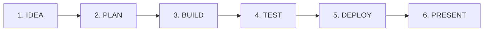

<div align="center">

# ⚡ BuildFlow

### **Turn your ideas into things that actually work.**

A high-performance, execution-first planning and delivery workspace built for students, hackathon builders, and independent developers.

[](https://buildflow-ai-livid.vercel.app/)
[](https://github.com/abinivesh-m/buildflow-ai)
[](https://opensource.org/licenses/MIT)
[](https://vitejs.dev)

---

### 🌐 [**Open Live Production App**](https://buildflow-ai-livid.vercel.app/) • 📦 [**GitHub Repository**](https://github.com/abinivesh-m/buildflow-ai)

</div>

---

## 🎯 The Core Problem

Most builders don't fail because they lack ideas—they fail in **execution**:
- **Ambiguous Scope:** Underestimating technical complexity and suffering from runaway scope creep.
- **Lost Architecture Context:** Forgetting *why* certain technologies, schemas, or trade-offs were chosen.
- **Unverified Deliverables:** Skipping edge-case checks, responsiveness audits, and security validations.
- **Rushed Demos:** Scrambling on demo day with broken live workflows, unhandled errors, and unstructured pitch narratives.

**BuildFlow forces execution over vanity dashboards**, walking builders through the entire delivery lifecycle:



---

## ✨ Stand-Out Capabilities

### 1. 📐 18-Point Engineering Blueprint
Transforms a raw prompt into an exhaustive engineering blueprint:
- **Problem Statement & Target Users**
- **User Needs & Proposed Solution**
- **MVP Scope Boundaries & Explicit Non-Goals**
- **Functional & Non-Functional Requirements**
- **User Stories & Objective Acceptance Criteria**
- **Technical Architecture & Relational Data Models**
- **Implementation Phases with Effort Hour Estimates**
- **Testing Strategy & Deployment Readiness Plan**
- **Presentation Demo Script & Potential Risks with Mitigations**

### 2. ⚡ Honest Planning Engine (Zero Fake AI)
- **Built-in Deterministic Rule Engine:** Instant, zero-latency blueprint generation in the browser with **zero external API dependencies**.
- **Optional Server-side Gemini 2.5 Flash:** Safely proxies prompts through `/api/generate.js` without leaking client secrets.
- **Transparent Source Attribution:** Every blueprint clearly displays its generator engine origin. Never passes off deterministic code as an AI model.

### 3. 📋 Dependency-Guarded Task Execution
- Tasks track unique IDs, priority (`critical`, `high`, `medium`, `low`), estimated hours, acceptance criteria, notes, and blocker logs.
- **Strict Dependency Enforcement:** Prevents marking tasks as `done` if prerequisite dependencies remain incomplete.
- **Truthful Progress Metrics:** Calculated strictly from persisted task statuses:
  $$\text{Progress} = \left(\frac{\text{Completed Tasks}}{\text{Total Tasks}}\right) \times 100\%$$

### 4. 🏛️ Technical Decision Records (TDR)
Capture critical architectural decisions directly inside your workspace:
- Context & Problem Statement
- Options Evaluated vs. Chosen Option
- Architectural Reasoning & Accepted Consequences
- Status (`proposed`, `accepted`, `deprecated`, `superseded`)
- One-click export to Markdown for inclusion in Git repositories.

### 5. 🧪 Testing & Quality Checklist
Real manual and automated quality verification covering:
- Core Domain Logic & Input Validation
- Data Persistence & Migration Safeguards
- Small Viewport Mobile Responsiveness (360px - 390px)
- Keyboard Focus & Accessibility (WCAG 2.2 AA standards)
- Zero fake auto-passes: checks require deliberate tester verification.

### 6. 🚀 Deployment Readiness Center
Pre-flight operational checks before publishing:
- Production build verification (`npm run build`)
- Secret hygiene audits (zero committed `.env` tokens)
- Live HTTPS reachability tests with response code verification.

### 7. 🎤 Demo & Presentation Studio
- Structured presentation script with adjustable target durations (e.g., 3-minute hackathon pitch).
- Live walkthrough narrative and feature highlights.
- Pre-flight demo checklist (screens checked, backup screenshots ready, credentials validated).
- Instant export to plain text or Markdown.

### 8. 💾 Complete Data Portability & Local-First Privacy
- **Local-First Storage:** All data lives in your browser with multi-version schema migration support (`v1`, `v2`, and `v3`).
- **Comprehensive Backups:** Full JSON backup and restore.
- **Real-Data Exports:** Full Blueprint (.md), README.md, Tasks (.csv), and TDRs (.md).

---

## 🛠️ Technology Stack

| Layer | Technologies |
| :--- | :--- |
| **Frontend Framework** | React 19, Vite 8.3 |
| **Icons & Visuals** | Lucide React, Canvas Confetti |
| **Styling & Tokens** | High-contrast Linear/Vercel-grade design system, Plus Jakarta Sans, JetBrains Mono |
| **Test Automation** | Vitest 5.0 (Unit, Workflow, & Schema integration suites) |
| **Code Quality** | Oxlint (Rust-based linter) |
| **Hosting & CI/CD** | Vercel Edge Network with automated continuous Git deployment |

---

## 🚀 Getting Started Locally

### Prerequisites
- [Node.js](https://nodejs.org/) v18+ (tested on v20 and v24)
- [npm](https://www.npmjs.com/) v9+

### Quick Setup

```bash
# 1. Clone the repository
git clone https://github.com/abinivesh-m/buildflow-ai.git
cd buildflow-ai

# 2. Install dependencies
npm install

# 3. Start local development server (runs live on http://localhost:5173/)
npm run dev
```

### Running Tests

```bash
# Execute the full automated test suite
npm test
```

### Production Build

```bash
# Compile and optimize for production
npm run build

# Preview production build locally
npm run preview
```

---

## 🧪 Test Coverage & Verification

BuildFlow features an automated test suite executed with Vitest:

```text
 ✓ src/workflow.test.js (5 tests passed)
   - Dependency constraint prevents completing task if upstream task is incomplete
   - Destructive actions preserve user tasks on plan regeneration
   - Calculated metrics strictly match task counts without fabrication
   - Technical Decision Records are initialized and structured
   - Testing and Deployment readiness checklists require deliberate verification

 ✓ src/engine.test.js (5 tests passed)
   - Generates comprehensive 18-point plan and all workspace modules
   - Tasks have valid priorities, estimates, acceptance criteria, and status
   - Progress calculation strictly uses real task completion numbers
   - StatusOf returns correct status reflecting task states
   - Docs exports generate valid Markdown, CSV, and Readme with real data

 ✓ src/intake.test.js (8 tests passed)
   - Natural language and voice dictation parser extracts constraints accurately

Test Files:  3 passed (3)
Tests:       18 passed (18)
Duration:    341ms
```

---

## 🌍 Live Production Deployment

| Target | URL |
| :--- | :--- |
| **Production Application** | [https://buildflow-ai-livid.vercel.app/](https://buildflow-ai-livid.vercel.app/) |
| **Continuous Git Branch** | [https://buildflow-ai-git-main-abinivesh-m.vercel.app/](https://buildflow-ai-git-main-abinivesh-m.vercel.app/) |
| **GitHub Source Repository** | [https://github.com/abinivesh-m/buildflow-ai](https://github.com/abinivesh-m/buildflow-ai) |

---

## 🔐 Environment Variables (Optional)

BuildFlow operates with 100% functionality out of the box using its built-in rule engine. If you want to enable the optional serverless AI proxy:

```env
# Optional: Google Gemini API key for server-side plan enrichment
GEMINI_API_KEY=your_gemini_api_key_here
GEMINI_MODEL=gemini-2.5-flash

# Application Configuration
NODE_ENV=production
```

---

## 📄 License

Distributed under the **MIT License**. See `LICENSE` for more information. Built for students, builders, and hackathon competitors worldwide.
