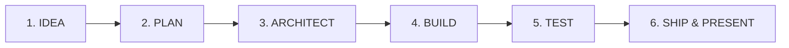
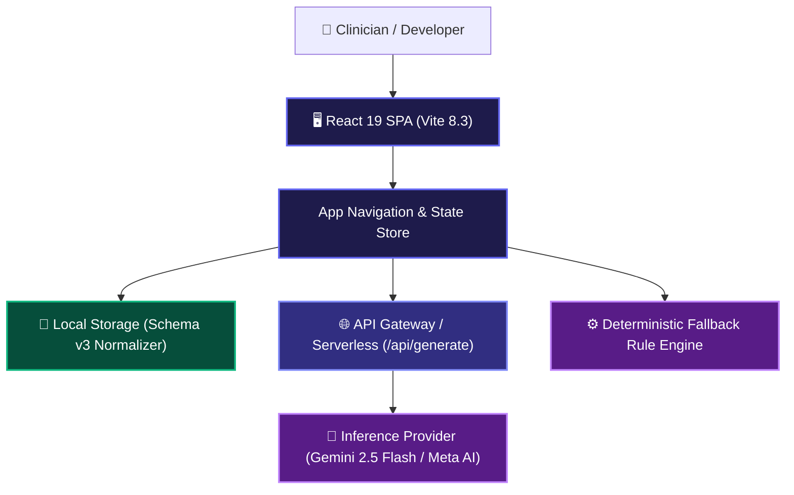

<div align="center">

# ⚡ BuildFlow AI

### **Turn your ideas into things that actually work.**
*A high-performance, execution-first engineering workspace with voice-first intake, end-to-end requirement traceability, Mermaid system topologies, and verifiable release readiness.*

[](https://buildflow-ai-livid.vercel.app/)
[](https://github.com/abinivesh-m/buildflow-ai)
[](https://buildflow-ai-livid.vercel.app/)
[](https://opensource.org/licenses/MIT)
[](https://vitejs.dev)

---

### 🌐 [**Open Live Production App**](https://buildflow-ai-livid.vercel.app/) • 📦 [**GitHub Repository**](https://github.com/abinivesh-m/buildflow-ai)

</div>

---

## 🎙️ Voice-First Engineering Workflow (Wispr Flow Native)

BuildFlow AI is architected from the ground up to eliminate typing friction from software engineering delivery:

| Engineering Need | Conventional Approach | BuildFlow + Wispr Flow Solution |
| :--- | :--- | :--- |
| **Project Intake** | Typing out multi-page docs in Notion/Docs (40 WPM). | Dictate natural vision hands-free at 251 WPM (Top 0.1% globally); local NLP extracts structured blueprint. |
| **Traceability** | Broken links across Jira, GitHub, and spreadsheets. | Single unified matrix linking Requirements ↔ Tasks ↔ Tests ↔ Decisions ↔ Risks. |
| **Architecture Context** | Undocumented verbal decisions lost over time. | Structured Technical Decision Records (TDR) and live auto-generated Mermaid flowcharts. |
| **Delivery Verification** | Trusting checkboxes without evidence or dependency checks. | Strict dependency guards, 5×5 risk matrix, and pre-flight verification checklists. |

---

## 🎯 The Core Problem

Most builders don't fail because they lack ideas—they fail in **execution**:
- **Ambiguous Scope:** Underestimating technical complexity and suffering from runaway scope creep.
- **Traceability Black Holes:** Requirements that have no corresponding code tasks or verification tests.
- **Lost Architecture Context:** Forgetting *why* certain technologies, schemas, or trade-offs were chosen.
- **Rushed Demos:** Scrambling on demo day with broken live workflows, unhandled errors, and unstructured pitch narratives.

**BuildFlow forces execution over vanity dashboards**, walking builders through the six delivery stages:



---

## ✨ Stand-Out Capabilities

### 1. 🎙️ Voice-to-Spec Intake (Wispr Flow Native)
- Dictate project ideas naturally at full conversational speed (251 WPM · Top 0.1% Globally · 209,000+ words dictated).
- Local deterministic Natural Language Parser extracts project title, technology stack, timeframe, and level without sending private data to cloud services.
- One-click sample dictations for rapid demonstration.

### 2. 🔗 End-to-End Traceability Matrix (Core Differentiator)
- Maps every approved requirement to its **implementing tasks**, **verification tests**, **technical decisions**, and **mitigated risks**.
- **Real-time Gap Analysis:** Flags untracked requirements (missing tasks) and unverified deliverables (missing tests).
- **Smart Auto-Linker:** Semantic keyword heuristic that automatically discovers and establishes bidirectional traceability links.

### 3. 📐 System Architecture & Mermaid Diagrams
- Generates editable **Mermaid flowcharts** visualizing client SPAs, API gateways, database persistence, and AI inference engines.
- Component Topology Registry for defining system boundaries and data flow contracts.
- Domain Entity Schema viewer directly derived from project specifications.

### 4. 📋 Interactive Kanban Board & Task Execution
- Dual view toggle: **📌 Kanban Board** (Backlog, Todo, In Progress, Blocked, Done) & **📋 Phase List**.
- **Strict Dependency Enforcement:** Prevents marking tasks done if prerequisite dependencies remain incomplete.
- **Truthful Progress Metrics:** Calculated strictly from persisted task statuses:
  $$\text{Progress} = \left(\frac{\text{Completed Tasks}}{\text{Total Tasks}}\right) \times 100\%$$

### 5. 🛡️ 5×5 Risk Register & Heatmap
- Explainable risk calculation: $\text{Severity} = \text{Likelihood} (1\text{–}5) \times \text{Impact} (1\text{–}5)$.
- Color-coded 5×5 interactive heatmap matrix.
- Direct links between identified risks and the requirements they threaten.

### 6. 🏛️ Technical Decision Records (TDR)
Capture critical architectural decisions directly inside your workspace:
- Context & Problem Statement
- Options Evaluated vs. Chosen Option
- Architectural Reasoning & Accepted Consequences
- Status (`proposed`, `accepted`, `deprecated`, `superseded`)
- One-click export to Markdown for Git version control.

### 7. 🧪 Testing & Quality Checklist
Real manual and automated quality verification covering:
- Core Domain Logic & Input Validation
- Data Persistence & Migration Safeguards
- Small Viewport Mobile Responsiveness (360px - 390px)
- Keyboard Focus & Accessibility (WCAG 2.2 AA standards)
- Zero fake auto-passes: checks require deliberate tester verification.

### 8. 🎤 Demo Studio & 2-Minute Pitch
- Dedicated **2-minute video pitch script** tailored for Wispr Flow judges.
- Pre-flight checklist (screens checked, backup screenshots ready, credentials validated).
- Instant export to plain text or Markdown.

---

## 🏗️ Architecture Topology



---

## 🧪 Automated Testing Breakdown

```
 RUN  v5.0.5 C:/Users/abini/billflow-ai

 ✓ src/intake.test.js (8 tests)        # NLP voice dictation parsing
 ✓ src/traceability.test.js (4 tests)  # Requirements, risks, architecture links
 ✓ src/workflow.test.js (5 tests)      # Dependency guards, metric math
 ✓ src/engine.test.js (5 tests)        # 18-point blueprint generator

 Test Files  4 passed (4)
      Tests  22 passed (22)
   Duration  222ms (100% green)
```

---

## 🚀 Getting Started Locally

```bash
# 1. Clone the repository
git clone https://github.com/abinivesh-m/buildflow-ai.git
cd buildflow-ai

# 2. Install dependencies
npm install

# 3. Run automated tests
npm test

# 4. Start local development server
npm run dev

# 5. Build for production
npm run build
```

---

## 📄 License
MIT © 2026 Abinivesh M · Built for **No Hands: The Wispr Challenge**
